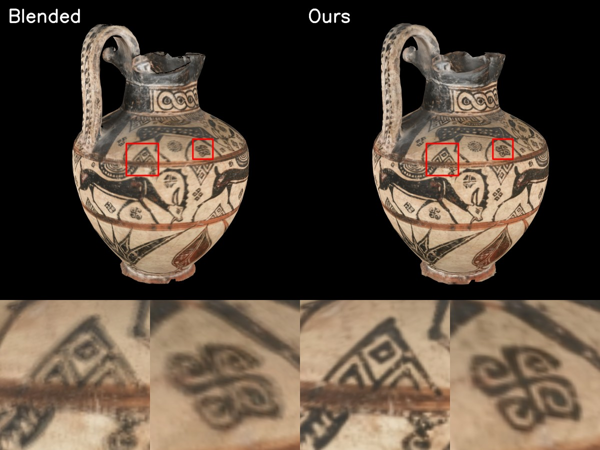

# Texture Consolidation

Code for the paper **Texture Consolidation of Generated Multi-View Renderings**.

Given a texture-atlased triangle mesh and a few renderings or photographs of it with known cameras, the code produces a single seamless texture image. It has three steps:

| Step | Program | What it does |
|---|---|---|
| 1 | `BackProjection` | Projects each image onto the mesh, giving a texture and a confidence image per view (Sec. 6.1). |
| 2 | `TextureFlow` | Registers the per-view textures to each other with optical flow on the surface (Sec. 6.2). |
| 3 | `TextureDomainStitching` | Fuses the registered textures into one texture by gradient-domain stitching (Sec. 6.3). |

`TextureDomainStitching` is built from [TextureSignalProcessing](https://github.com/mkazhdan/TextureSignalProcessing).

## Building

Clone with the submodules ([Misha](https://github.com/mkazhdan/Misha), [PhongRodriguesVF](https://github.com/mkazhdan/PhongRodriguesVF), [TextureSignalProcessing](https://github.com/mkazhdan/TextureSignalProcessing)):

```bash
git clone --recursive https://github.com/hliuw/TextureConsolidation.git
cd TextureConsolidation
```

The code needs a C++20 compiler, CMake, OpenMP, and the libpng, libjpeg and zlib libraries.

### Linux

Tested on Ubuntu 24.04 with gcc 13.3 and CMake 3.28.

```bash
sudo apt install cmake libpng-dev libjpeg-dev zlib1g-dev
cmake -S . -B build -DCMAKE_BUILD_TYPE=Release
cmake --build build -j
```

The programs are in `build/`.

### Windows

We recommend Visual Studio with [vcpkg](https://github.com/microsoft/vcpkg). Tested with Visual Studio 2026 (MSVC 19.51), CMake 4.2, and vcpkg (libpng 1.6.58, libjpeg-turbo 3.1.4, zlib 1.3.2).

```bash
cmake -S . -B build -DCMAKE_TOOLCHAIN_FILE=<vcpkg>/scripts/buildsystems/vcpkg.cmake
cmake --build build --config Release
```

vcpkg installs libpng, libjpeg and zlib automatically (see `vcpkg.json`). The programs are in `build/Release/`.

If you prefer not to use vcpkg, you can install libpng, libjpeg and zlib yourself and tell CMake where they are, e.g. with `-DCMAKE_PREFIX_PATH=<folder containing the libraries>`. CMake finds them with its standard `find_package` modules. We have not tested this setup.

## Data format

A dataset is a folder with three parts:

- **Mesh:** a texture-atlased triangle mesh, as a binary PLY with `vertex_indices` and a per-face `texcoord` list (6 values per triangle).
- **Cameras:** `cameras.json` in this format:
  ```json
  { "frames": [ { "w": 1002, "h": 1336, "fx": 4488.7, "fy": 4488.7, "cx": 501.0, "cy": 668.0,
                  "w2c": [ [...], [...], [...], [0, 0, 0, 1] ], "file_path": "images/0.png" }, ... ] }
  ```
  `w2c` is the 4×4 world-to-camera matrix, and `fx, fy, cx, cy` are the pinhole intrinsics in pixels.
- **Images:** one rendering or photograph per camera, at the `file_path` given in `cameras.json` (relative to the folder of `cameras.json`). For example, the vase used in the [example run](#example-run) has 9 photographs:

  

Views are numbered `0 .. N-1` in the order of `cameras.json`. Files belonging to view `i` are named with a `%d` pattern, e.g. `backprojected/%d.png` means `backprojected/0.png`, `backprojected/1.png`, ...

**Using your own data:** two things should be noted.
- The default parameters of `TextureFlow` were tested on meshes with a surface area of about 5 (e.g. the example vase). The flow parameters depend on the size of the mesh, so scale your mesh (and the camera translations) to roughly that size.
- `TextureDomainStitching` requires a clean texture atlas. Otherwise it may stop with errors such as "Bad components", or crash. In that case, regenerate the atlas, for example with [xatlas](https://github.com/jpcy/xatlas).

## Example run

This example uses 9 photographs of a vase, with its mesh and cameras. Download and unpack the data:

```bash
curl -L -o vase.zip https://github.com/hliuw/TextureConsolidation/releases/download/untagged-744bd3bf0bbe92dce324/vase.zip
unzip vase.zip
```

Then run the three steps (on Windows, use `build/Release/` instead of `build/`):

```bash
build/BackProjection --mesh vase/mesh.ply --cameras vase/cameras.json --outTextures vase/backprojected/%d.png --outConfidences vase/backprojected/%d.confidence.png
build/TextureFlow --mesh vase/mesh.ply --inTextures vase/backprojected/%d.png --inConfidences vase/backprojected/%d.confidence.png --outTextures vase/registered/%d.png --outConfidences vase/registered/%d.confidence.png
build/TextureDomainStitching --in vase/mesh.ply vase/registered/%d.png --mask vase/registered/%d.confidence.png --multi --wType 1 --erode 1 --erodeEps 0.1 --out vase/texture.png
```

The result is `vase/texture.png`. `vase/mesh.ply` refers to this texture, so you can view the textured vase in a third-party mesh viewer such as [MeshLab](https://www.meshlab.net/).

Below, *Blended* is the confidence-weighted average of the back-projected photographs, without registration or stitching. Because the photographs do not align perfectly on the surface, edges appear doubled and blurred. *Ours* is the result of the three steps above. The bottom row shows close-ups of the two boxes.



## Programs

### BackProjection

| Option | Default | Description |
|---|---|---|
| `--mesh` | | input mesh |
| `--cameras` | | input `cameras.json` |
| `--images` | folder of `cameras.json` | folder the image paths are relative to |
| `--outTextures`, `--outConfidences` | | output patterns, e.g. `backprojected/%d.png` |
| `--res` | `1024 1024` | texture resolution |
| `--depthRadius` | `20` | falloff of the confidence near depth discontinuities, in pixels ($r_{dc}$) |
| `--cutoff` | `0.05` | confidences below this are set to zero |

### TextureFlow

| Option | Default | Description |
|---|---|---|
| `--mesh` | | input mesh |
| `--inTextures`, `--inConfidences` | | input patterns (the output of `BackProjection`) |
| `--outTextures`, `--outConfidences` | | output patterns for the registered textures |
| `--levels` | `6` | number of hierarchy levels ($L$) |
| `--sDiffusion` | `3e-4` | smoothing of the source and target ($\beta_{blur}$) |
| `--sWeight` | `0.5` | smoothness of the flow ($\beta_{reg}$) |
| `--factor` | `0.5` | scaling of $\beta_{blur}$ and $\beta_{reg}$ per level |
| `--normalization` | `1e-3` | extent of the color normalization ($\epsilon_n$) |
| `--sub` | `1` | 1-to-4 subdivisions of the mesh |
| `--erodeR`, `--erodeT` | `1`, `0.2` | erosion of the confidences near their boundary (radius in texels, threshold) |
| `--minC` | `1e-8` | minimum confidence |
| `--minStep` | `1e-2` | minimum advection step size |

### TextureDomainStitching

See the [TextureSignalProcessing documentation](https://github.com/mkazhdan/TextureSignalProcessing) for all options. For this pipeline, use:

| Option | Description |
|---|---|
| `--in <mesh> <texture pattern>` and `--mask <confidence pattern>` | the registered textures and confidences |
| `--multi` | **required**: stitch multiple textures |
| `--wType 1` | **required**: weight both the value and the gradient terms by confidence (Eq. 7) |
| `--erode 1 --erodeEps 0.1` | recommended: ignore unreliable texels at chart boundaries |
| `--gWeight` | gradient fitting weight ($\alpha_{gf}$), default `0.01` |
| `--out` | output texture |

## Citation

```bibtex
TODO
```
